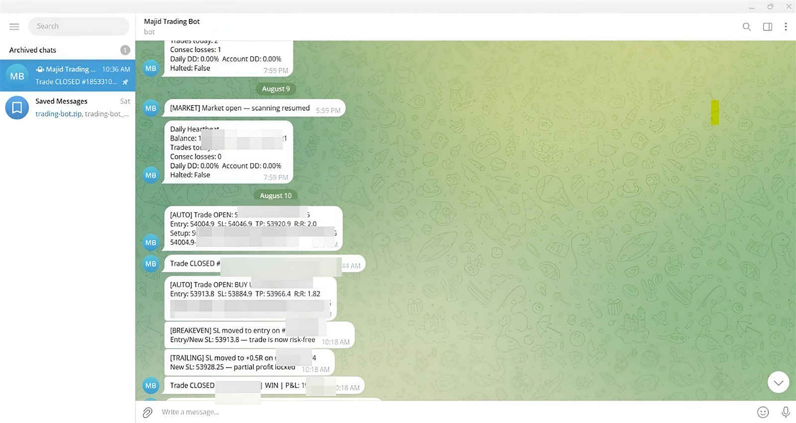
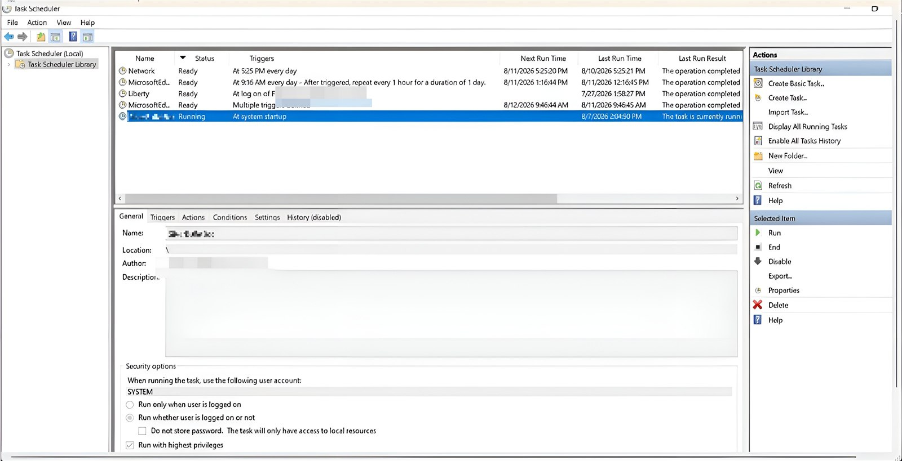

# Trading bot — the engineering around the strategy

An automated futures-index trading bot that has been running unattended on a
Windows VPS since 2026, placing and managing real orders through a broker API.

**Python · cTrader Open API · MetaTrader 5 · Windows Task Scheduler · Telegram**

---

## What is in this repository, and what is not

**The trading logic is not published here.** The entry rules, the tuned parameters,
the session windows and the trade history belong to a system that is live and
running money, and none of that is anybody else's to read.

What is here is everything around it — the part that decides whether a strategy
survives contact with a real broker on a real server:

- connecting to a broker, authenticating, and keeping the session alive
- placing orders, modifying stops, and handling the dozen ways a broker says no
- running unattended for weeks, restarting itself, and telling someone when it does not
- not trading through a news release
- proving any of it works without touching a live account

A strategy is a page of rules. This is the other several thousand lines.

| Live alerts from the running bot | Running unattended on the VPS |
|---|---|
|  |  |
| Every open, stop move, break-even and close is reported, with a daily heartbeat so silence is itself a signal. Account figures are blurred. | Starts at system boot, runs whether anyone is logged in, survives reboots. The task name is blurred because it names the strategy. |

---

## Connecting to a broker

| File | What it does |
|---|---|
| `ctrader_link.py` | cTrader Open API over a websocket: authentication, token refresh, account selection, reconnection. Refuses to pick a live account by itself — if more than one account answers, it stops and asks which. |
| `ctrader_trade.py` | Placing, modifying and closing orders. |
| `ctrader_check.py` | A pre-flight check: are the keys present, is the account the expected one, is the symbol tradeable, is the spread sane. Run before trusting anything. |
| `mt5_ctrader.py` | A MetaTrader 5–shaped shim over cTrader. The bot was written against the MT5 API; this lets the same code run on a broker that has no MT5, without a rewrite. |
| `keys_bharo.py` | Writes the credentials file without ever echoing a value to the screen — it reports "filled" or "empty", never the secret itself. |

## Running unattended

| File | What it does |
|---|---|
| `run_vwap.py` | The watchdog: starts the bot, watches it, restarts it if it dies, and reports. |
| `rutin.py` | The daily check — did the scheduled tasks run, did the scans happen on the bar, is anything silently failing. |
| `dst_jaanch.py` | Daylight saving. The broker's server clock, the exchange's session and the VPS clock move on different dates; a bot that assumes they agree trades an hour early twice a year. |
| `news_shadow.py` | Blocks trading around scheduled news. `news_dates.txt` is the calendar. |
| `chat_id_nikalo.py` | Finds the Telegram chat id for alert delivery. |

## Getting onto the server

| File | What it does |
|---|---|
| `build_vps.py` | Builds the deployment bundle: only the files the server needs, with a manifest, so what is on the VPS is a known set rather than whatever was copied last. |
| `make_task_xml.py` | Generates the Task Scheduler definition — run at startup, highest privileges, restart on failure. |
| `sab_chalu.bat` / `sab_band.bat` | Start everything / stop everything, from one place. |
| `fix_start_bat.py` | Repairs the startup script in place when paths move. |

## Testing it without a broker

`sim_harness.py` is a simulated broker: it answers the same calls the real API
answers, including the failures — rejected orders, requotes, stale ticks,
disconnections — so the bot's behaviour under a broker having a bad day can be
tested on a laptop, deliberately, instead of being discovered live.

The tests here run against it:

```
test_link.py            broker connection, token refresh, account selection
test_task_xml.py        the generated scheduled task is what was intended
test_watchdog.py        the bot is restarted when it dies, and only then
test_weekend_cmds.py    nothing trades when the market is shut
test_weekend_v437.py    the weekend rules after a change that touched them
test_dst_jaanch.py      the clocks still agree across a DST change
```

They are a subset: the tests that cover the trading logic are not published,
for the same reason the logic is not.

---

## Why it looks like this

**Credentials are never in the repository and never on screen.** They live in a
file that git is configured to refuse, and the tool that writes it prints "filled"
or "empty" rather than the value. The sample is `ctrader_keys_NAMOONA.json`, with
placeholders.

**The bot assumes the broker will misbehave.** Retries are limited to the error
codes where a retry is safe; a rejection that might mean the order *did* arrive is
never retried blindly. Orders are de-duplicated inside a time window, because the
expensive failure is two positions where one was intended.

**Silence is reported.** A daily heartbeat goes out whether or not anything traded,
so a bot that has quietly died looks different from a bot that found no setup.

**It is Windows Task Scheduler, not a service wrapper.** The VPS is Windows because
the broker terminal is; using the scheduler the OS already has means one less thing
to fail at 3 a.m.
